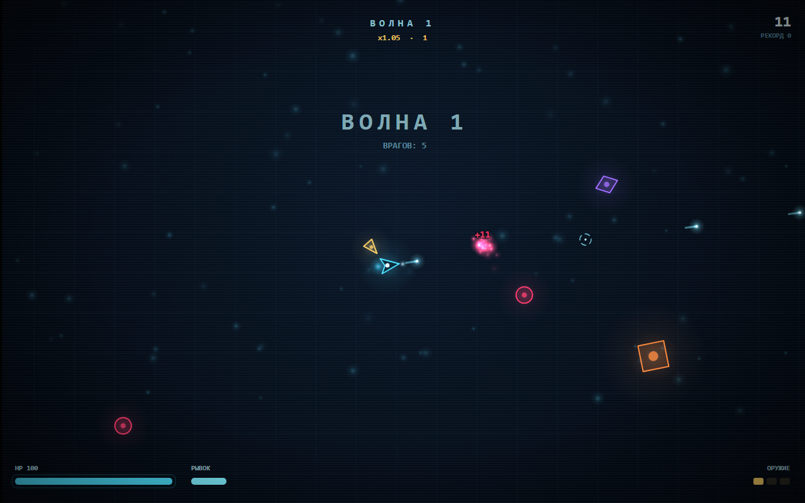

# НЕОН-АРЕНА

2D-арена-шутер для браузера: волны врагов, неоновая арена, синтезированный звук.
Чистый HTML/CSS/JS, без библиотек, сборки и интернета — всё работает локально.



## Запуск

Открой `index.html` двойным кликом — игра сразу работает через `file://`.

Если браузер капризничает с локальными файлами, подними простой сервер:

```powershell
python -m http.server 8000
# затем http://localhost:8000
```

## Управление

| Клавиши | Действие |
| --- | --- |
| `W` `A` `S` `D` / стрелки | движение |
| мышь | прицел, удержание ЛКМ — огонь |
| `Пробел` / `Shift` | рывок (неуязвимость + урон врагам) |
| `Esc` / `P` | пауза |
| `M` | звук вкл/выкл |
| `Enter` / `R` | старт и рестарт |

Нужны клавиатура и мышь: на тач-устройствах игра не рассчитана.

## Что внутри

- **4 типа врагов**: быстрый «бегун», юркий «зиппер» с волновым движением,
  стреляющий «сплиттер» и тяжёлый «брут», который при смерти распадается на двух бегунов.
- **Бесконечные волны** с растущим бюджетом спавна и запасом HP.
- **Три уровня оружия** (одиночный / двойной / тройной залп), аптечки и бонусы.
- **Рывок** с кадрами неуязвимости и разовым уроном — им можно проходить сквозь толпу.
- **Комбо-множитель** за серию убийств, рекорд в `localStorage`.
- Частицы, свечение, тряска камеры, всплывающие цифры урона.
- Звук целиком синтезируется в WebAudio: ни одного аудиофайла.
- Адаптивный canvas под размер окна и Retina (`devicePixelRatio`).

## Файлы

```
index.html      разметка и оверлеи (меню, пауза, финал)
style.css       неоновая оболочка интерфейса
game.js         вся игра: цикл, физика, враги, волны, эффекты, звук
tests/smoke.js  автотест логики без браузера
preview.png     скриншот
```

## Тесты

Нужен Node.js 18+.

```powershell
node tests/smoke.js
```

Тест подменяет DOM и canvas заглушками, прокручивает игровой цикл и проверяет
старт, спавн врагов, стрельбу и начисление очков, урон, смену волн, паузу,
смерть, сохранение рекорда и рестарт. Тот же тест запускается в GitHub Actions
на каждый push и pull request.

## Отладка

- `index.html?auto=1` — старт без клика по кнопке.
- В консоли доступен `window.__arena`: состояние, волна, очки, список врагов,
  а также `start()`, `spawn(type, x, y)`, `hit(n)`, `clear()`.

## Лицензия

MIT — см. [LICENSE](LICENSE).
